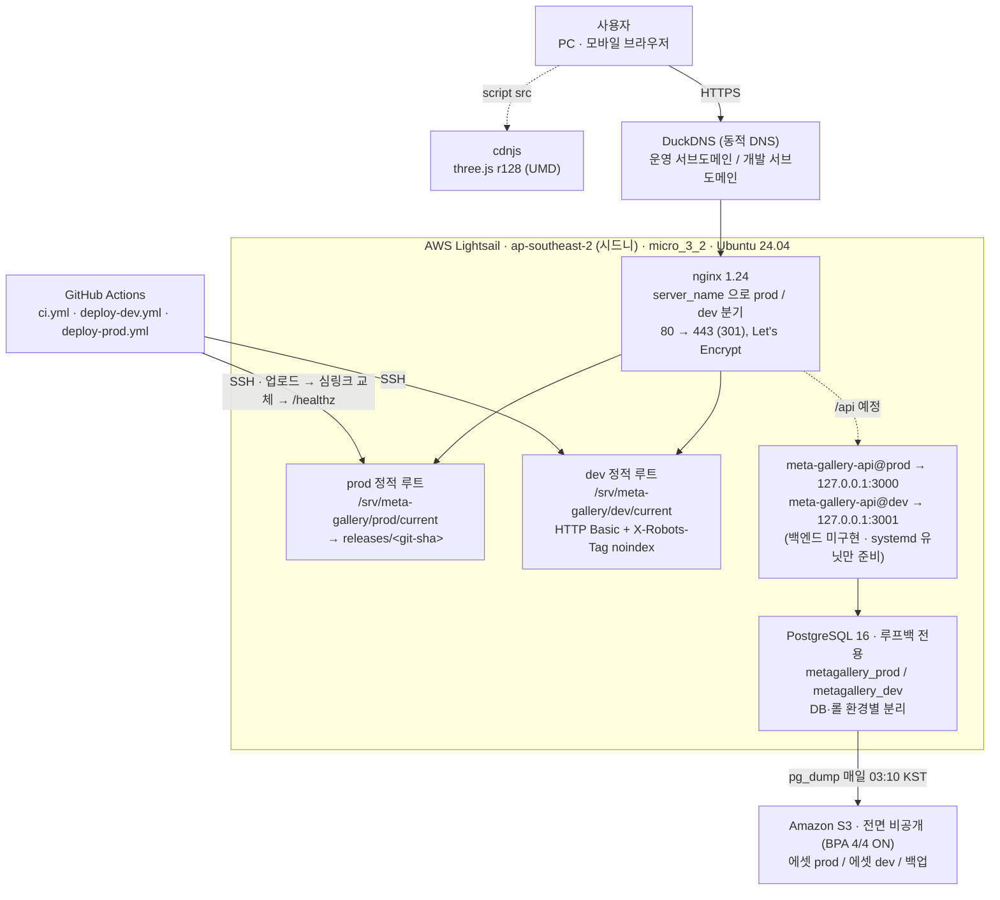

# 메타 갤러리 — 금경희의 포트폴리오 개인전

**고양이가 되어 나선 램프를 걸어 올라가며 GitHub 공개 저장소를 감상하는 3D 웹 전시관.**
빌드 도구도, 번들러도, 패키지 매니저도 없이 **HTML 파일 하나**로 돌아간다.

### 🔗 [https://metagallery.duckdns.org/](https://metagallery.duckdns.org/) — 지금 바로 열어 볼 수 있습니다


-F7DF1E?logo=javascript&logoColor=black)


---

## 목차

1. [무엇인가](#1-무엇인가)
2. [화면 구성과 조작법](#2-화면-구성과-조작법)
3. [아키텍처](#3-아키텍처)
4. [기술적으로 설명할 만한 결정](#4-기술적으로-설명할-만한-결정)
5. [실제로 겪은 문제와 해결](#5-실제로-겪은-문제와-해결)
6. [로컬에서 실행하기](#6-로컬에서-실행하기)
7. [디렉터리 구조](#7-디렉터리-구조)
8. [배포](#8-배포)
9. [한계와 다음 계획](#9-한계와-다음-계획)
10. [English summary](#10-english-summary)

---

## 1. 무엇인가

안쪽이 비어 있는 원통형 전시관 벽면을 따라 **나선 램프**가 2바퀴 감아 올라간다.
관람자는 고양이 캐릭터가 되어 로비에서 출발해 램프를 걸어 오르고, 벽에 걸린 작품을 누르면
설명 패널이 열린다. 꼭대기에는 천창이 있어 위로 갈수록 밝아진다.

**전시된 "작품"은 그림이 아니라 GitHub 공개 저장소다.** 저장소 이름·주 언어·최근 갱신일·설명을
액자 모양 카드로 그려 걸었고, 카드를 누르면 실제 저장소로 가는 링크가 열린다.

> **작품 데이터는 2026-11-13에 조회한 값을 코드에 박아 둔 상수다.**
> 실행 중에 GitHub API를 호출하지 않는다(네트워크 요청이 0건인 설계 — [4-5](#4-5-런타임-네트워크-요청-0건--개인정보를-수집하지-않는다) 참고).
> 설명이 등록되지 않은 저장소는 설명을 지어내지 않고 "등록되지 않았다"고 그대로 적는다.
> 화면에 보이는 관람객 고양이·대화·관람 인원은 **분위기를 위한 예시**이며 실제 다른 사용자가 아니다(화면에 `예시` 배지로 표시).

### 이 프로젝트가 보여주려는 것

| 영역 | 내용 |
|---|---|
| **3D 그래픽** | three.js r128(UMD)만으로 나선 램프 지오메트리, 캐릭터 리깅 없는 절차적 걷기·점프 애니메이션, 캔버스 2D로 그린 절차적 작품 텍스처 |
| **제약 안에서의 엔지니어링** | 빌드 도구 없음 · 단일 파일 · 외부 의존성 1개(three.js CDN) · 서버 전송 0건 |
| **인프라** | Terraform으로 코드화한 AWS Lightsail + S3, 인스턴스 1대에 운영/개발 2환경, Let's Encrypt HTTPS, PostgreSQL 16, 백업·감시 타이머 |
| **CI/CD** | GitHub Actions 3개 워크플로, 릴리스 심링크 교체 배포와 `/healthz` 실패 시 자동 롤백, 자체 제작 평문 비밀값 검사기 + 회귀 테스트 |

---

## 2. 화면 구성과 조작법

### 화면 구성

| 영역 | 설명 |
|---|---|
| 상단 헤더 | 전시명, 작품 수, 현재 관람 인원(예시) |
| 평면도 | 전시관을 위에서 본 미니맵. 현재 위치와 층(로비 / 램프)을 표시 |
| 설명 패널 | 작품을 누르면 열린다. 저장소 이름·주 언어·최근 갱신일·설명·`GitHub에서 열기` 링크 |
| 투어 바 | `이전` / `다음`으로 작품을 차례대로 돌아본다. 카메라가 스스로 그 작품 앞으로 이동한다 |
| 전시실 대화 | 관람객 고양이들이 주고받는 말풍선(예시). 입력한 메시지는 메모리에만 남고 서버로 가지 않는다 |
| 시점 토글 | 3인칭(고양이 뒤) ↔ 1인칭 |

### 조작법 — PC (키보드·마우스)

| 입력 | 동작 |
|---|---|
| `W` `A` `S` `D` / 방향키 | 걷기. 카메라가 고양이 뒤를 따라간다 |
| `Space` | 점프 |
| `Q` `E` | 시점 좌우 회전 |
| 마우스 드래그 | 시점 회전 |
| `V` | 1인칭 ↔ 3인칭 전환 |
| 작품 클릭 | 설명 패널 열기 |

### 조작법 — 모바일 (터치)

| 입력 | 동작 |
|---|---|
| 화면 아무 곳이나 끌기 | 끈 방향으로 걷기 (가상 조이스틱 — 처음 닿은 곳이 중심이 된다) |
| 가볍게 탭 | 점프 |
| 작품 탭 | 설명 패널 열기 |
| 두 손가락 끌기 | 시점 회전 |

- 조작 안내는 `pointer: coarse` / 화면 폭으로 판별해 PC 문구와 터치 문구를 바꿔 보여 준다.
- `prefers-reduced-motion: reduce`를 존중해 불필요한 전환 애니메이션을 끈다.
- `env(safe-area-inset-*)`로 노치·홈 인디케이터 영역을 피한다.

---

## 3. 아키텍처



### 환경 분리 (인스턴스 1대, nginx `server_name`으로 분기)

| 구분 | prod | dev |
|---|---|---|
| 호스트 | `metagallery.duckdns.org` | `metagallery-dev.duckdns.org` |
| 정적 루트 | `/srv/meta-gallery/prod/current` | `/srv/meta-gallery/dev/current` |
| 백엔드 포트(예정) | `127.0.0.1:3000` | `127.0.0.1:3001` |
| systemd 유닛 | `meta-gallery-api@prod.service` | `meta-gallery-api@dev.service` |
| DB / 롤 | `metagallery_prod` / `mg_prod` | `metagallery_dev` / `mg_dev` |
| 접근 제한 | 없음(공개) | HTTP Basic + `X-Robots-Tag: noindex` |
| 헬스체크 | `/healthz` (nginx가 직접 200) | `/healthz` (Basic 인증 면제) |

외부로 열리는 포트는 nginx의 **80·443뿐**이다. 백엔드와 PostgreSQL은 루프백 전용이고,
SSH 22번은 관리자 단일 IP(`/32`)로만 열어 둔다. 그 IP 값은 저장소에 두지 않고
`terraform.tfvars`(미추적)에만 둔다.

### 감시 2층 구조

- **1층 — Lightsail 기본 지표 알람 4개**: CPU 사용률 / burst 잔량 / 네트워크 송신량 / 인스턴스 상태 점검
- **2층 — `scripts/ops/healthcheck.sh` (5분 주기 systemd timer)**: 디스크·inode·메모리·swap 사용률,
  nginx·PostgreSQL·DuckDNS 타이머·certbot 타이머 유닛 상태, `pg_isready`와 DB별 `SELECT 1`,
  `Host` 헤더를 붙인 루프백 `/healthz`, 인증서 남은 일수, 최신 `pg_dump` 경과 시간

> `/healthz`를 외부 DNS가 아니라 `127.0.0.1` + `Host` 헤더로 묻는 이유는 **DNS 장애와 앱 장애를 구분**하기 위해서다.
> 확인할 수 없는 항목(발급 전 인증서 등)은 `SKIP`으로 남기고 종료 코드에 넣지 않는다.

---

## 4. 기술적으로 설명할 만한 결정

### 4-1. 인스턴스 1대에 nginx `server_name`으로 dev/prod를 분리했다

**선택**: 환경별로 인스턴스를 따로 두지 않고, Lightsail 1대 안에서 `server_name`으로 가른다.
디렉터리(`/srv/meta-gallery/{prod,dev}`), systemd 템플릿 유닛(`meta-gallery-api@{prod,dev}`),
PostgreSQL DB·롤, nginx 로그 파일까지 환경별로 나누되 **하드웨어는 공유**한다.

**근거**: 인스턴스를 2대로 늘리면 비용이 정확히 두 배가 된다. 이 프로젝트의 개발계는
"운영 배포 전에 눈으로 한 번 보는 용도"라 상시 부하가 없다. 격리가 필요한 지점은
**데이터와 파일 경로**이지 커널이 아니라고 판단했다. 그래서 격리는 OS 수준(별도 DB·롤·유닛·디렉터리)에서 하고,
자원은 공유했다. 개발계에는 HTTP Basic 인증과 `X-Robots-Tag: noindex`를 걸어 검색 노출과 외부 접근을 막았다.

**감수한 것**: 한쪽이 인스턴스를 포화시키면 다른 쪽도 영향을 받는다. 운영계 부하가 생기면
그때 분리하는 것으로 미뤘다.

### 4-2. S3를 전면 비공개로 두고, 공개가 필요해지면 CloudFront + OAC로 간다

**선택**: 버킷 3개(에셋 prod/dev, 백업) 모두 Block Public Access **4항목 전부 ON**,
버전 관리 ON, 기본 암호화 ON. 버킷 정책으로 공개 읽기를 여는 길은 쓰지 않는다.

**근거**: "나중에 공개로 바꾸면 되지"가 가장 흔한 사고 경로다. 처음부터 공개를 **불가능**하게 만들어 두고,
공개가 실제로 필요해지면 **CloudFront + OAC(Origin Access Control)** 로 전환하는 설계 문서를 미리 써 뒀다.
이러면 버킷은 끝까지 비공개로 남고, 캐싱·전송 비용·접근 로그가 모두 CDN 계층으로 모인다.
S3 데이터 전송(아웃)은 월 비용이 가장 쉽게 튀는 항목이기도 하다.

### 4-3. 릴리스 심링크 교체 배포 + `/healthz` 실패 시 자동 롤백

```
/srv/meta-gallery/prod/
  releases/<git-sha>/          ← 배포 단위. 불변. 덮어쓰지 않는다
  releases/0000-bootstrap/     ← 첫 배포 전에도 nginx가 뜨도록 하는 안내 페이지
  current -> releases/<sha>    ← 이 심링크 하나만 바꿔서 전환
  shared/previous-release      ← 직전 sha. 롤백 대상 포인터
```

**선택**: 새 릴리스를 `releases/<sha>`에 통째로 설치한 뒤 **심링크만 원자적으로 교체**한다.
교체 직후 `current`가 가리키는 실제 파일의 sha256을 업로드한 산출물과 대조하고,
`/healthz`를 3초 간격으로 최대 10회 묻는다. 10회 연속 실패하면 스크립트가 스스로
직전 릴리스로 심링크를 되돌리고 nginx를 reload한다.

**근거**: 배포 중 파일을 제자리에서 덮어쓰면 그 짧은 순간에 반쯤 쓰인 파일이 서빙된다.
롤백도 "다시 빌드해서 다시 올리기"가 되어 느리다. 심링크 교체는 전환이 한 순간이고,
되돌리기도 같은 한 순간이다. 배포 계정(`deploy`)이 자기 소유 디렉터리의 심링크를 바꾸는 것이므로
**sudo도 필요 없다**(sudoers에는 `nginx -t`·`systemctl reload nginx`만 넣었다).

`/healthz`는 nginx가 고정 문자열을 돌려주는 엔드포인트라 "nginx가 살아 있다"만 증명한다.
그래서 sha256 대조를 **따로** 둔 것이다 — 헬스체크 하나로 배포 성공을 단정하지 않는다.

### 4-4. STAGE 1 / STAGE 2 nginx 구성 — 인증서가 없는 서버에서도 부트스트랩된다

**문제**: HTTPS 설정이 든 nginx 설정은 인증서 파일이 없으면 `nginx -t`부터 실패한다.
그런데 인증서(Let's Encrypt HTTP-01)를 받으려면 **nginx가 먼저 떠서 `/.well-known/acme-challenge/`를 서빙**해야 한다.
닭과 달걀이다.

**선택**: 저장소의 nginx 설정을 **STAGE 1(HTTP 전용 + ACME webroot)** 로 두고,
HTTPS 블록은 같은 파일 안에 **주석으로** 넣어 뒀다. `scripts/ops/enable-https.sh`가
인증서 발급 후 STAGE 1 → STAGE 2 전환을 수행한다. 이 스크립트는

- **멱등**하다(이미 STAGE 2면 아무 것도 하지 않는다),
- 원본을 `/var/backups/meta-gallery/provision/`에 백업하고,
- `nginx -t`가 실패하면 **자동으로 STAGE 1로 되돌린다.**

인증서 발급 자체도 순서를 고정했다: **staging `--dry-run` → 본 발급 → 자동갱신 리허설**.
Let's Encrypt 운영 발급 한도를 실수로 태우지 않기 위해서다.

### 4-5. 런타임 네트워크 요청 0건 — 개인정보를 수집하지 않는다

`localStorage` · `sessionStorage` · `cookie` · `fetch` · `XMLHttpRequest` · `geolocation`
**사용 0건.** 입력한 닉네임과 채팅은 자바스크립트 메모리 안에서만 살다가 탭을 닫으면 사라진다.
작품 데이터도 런타임에 가져오지 않고 상수로 박혀 있다. 외부로 나가는 요청은
three.js CDN과 웹폰트뿐이다. 수집하는 개인정보가 없으므로 동의 배너도, 개인정보 처리방침도,
서버측 저장소도 필요하지 않다.

### 4-6. CI에 자체 제작 비밀값 검사기와 그 회귀 테스트를 넣었다

`scripts/ci/secret-scan.py`는 AWS 액세스 키·개인키 블록·DB 접속 문자열의 비밀번호·
`*_PASSWORD`/`*_TOKEN`류 할당·공인 IP 하드코딩을 찾는다. 핵심은 **면제 규칙의 설계**다.

- 면제는 줄이나 파일이 아니라 **매치된 값 자체**에만 적용한다.
  (1차 구현은 줄 전체를 면제해서 심어 둔 9건 중 3건만 잡았다.)
- 자리표시자·마스크 토큰을 **제거한 뒤 영숫자가 8자 이상 연속으로 남으면 면제하지 않는다.**
  (2차 구현은 값 예외가 `search()`라서, 진짜 비밀번호 뒤에 가림 문자 `***`만 덧붙인 값이
  그대로 통과했다. 지금은 그 `***`를 제거한 잔여 문자열이 길면 면제하지 않는다.)
- `.example` 파일이라고 스캔에서 빼지 않는다. **값이 자리표시자인지**로 판정한다.

이 두 번의 실패 사례를 `scripts/ci/testdata/`에 고정 표본으로 남기고,
`scripts/ci/test-secret-scan.py`가 매 CI마다 재현한다. 기대값은 코드가 아니라 표본 파일의
`[[DETECT]]` 마커에서 읽으므로, 표본을 고쳐도 테스트가 어긋나지 않는다.
`known-limits.txt`는 **지금도 못 잡는 사례**를 고정해 두는 표본이라, 탐지되기 시작하면
테스트가 일부러 실패해 문서 갱신을 요구한다.

> 표본의 값은 전부 가짜다. 근거는 [`scripts/ci/testdata/README.md`](scripts/ci/testdata/README.md)에 값별로 적어 두었다.

---

## 5. 실제로 겪은 문제와 해결

설계 문서만으로는 드러나지 않고 **실제로 적용했을 때 비로소 나온** 것들이다.

### 5-1. S3 버킷 3개 생성 실패 — `InvalidTag`

Terraform 공통 태그 값에 가운뎃점(`·`)·괄호·쉼표를 쓰고 있었다. S3 태그 값은
유니코드 문자·숫자·공백과 `_ . : / = + - @` 만 허용한다. 다른 AWS 서비스에서는 통과하던
문자열이 S3에서만 거부됐다. 태그 값을 ASCII로 고정하고, `main.tf`에 허용 문자 범위를
주석으로 남겼다.

### 5-2. `apt` 중단 — `Package 'awscli' has no installation candidate`

프로비저닝 스크립트가 `apt install awscli`를 하고 있었다. **Ubuntu 24.04(noble) 저장소에는
`awscli` 패키지가 없다.** AWS CLI v2 공식 설치본(zip → `install`)으로 바꾸고, 이미 설치돼 있으면
건너뛰도록 멱등하게 만들었다.

### 5-3. `nginx -t` 실패 — `unknown directive "http2"`

HTTPS 블록을 `listen 443 ssl;` + `http2 on;`으로 썼다. `http2 on;`은 **nginx 1.25.1+ 문법**이고
Ubuntu 24.04 기본 nginx는 **1.24**다. `listen 443 ssl http2;` 형태로 되돌렸고,
nginx를 1.25.1 이상으로 올릴 때 다시 바꾸라는 안내를 설정 파일 주석에 남겼다.

> 이때 [4-4](#4-4-stage-1--stage-2-nginx-구성--인증서가-없는-서버에서도-부트스트랩된다)의
> 자동 롤백이 실제로 작동했다. `enable-https.sh`가 `nginx -t` 실패를 감지하고 STAGE 1로 되돌려,
> 설정이 깨진 채로 reload되는 일은 일어나지 않았다.

### 5-4. 감시 타이머가 전혀 돌지 않았고, 고치니 이번엔 상시 `failed`

프로비저닝 스크립트가 healthcheck 유닛과 스크립트를 **설치하지 않고 있었다.** 설치·활성화를 추가하자
이번에는 유닛이 늘 `failed` 상태였다. 원인은 healthcheck가 WARN을 종료 코드 1로 돌려주는데
systemd가 그것을 실패로 처리한 것이었다. `SuccessExitStatus=0 1`을 넣어 **CRIT(2)만 실패**로 보게 했다.

### 5-5. 운영계 HTTPS 10분 중단 — provision 재실행이 운영 상태를 되돌렸다

가장 뼈아픈 건이다.

| 항목 | 내용 |
|---|---|
| 증상 | 운영계 443 연결 거부. 80은 200 응답, 인스턴스·DNS 정상 |
| 경위 | 5-4의 감시 타이머 결함을 고치려고 `provision.sh`를 재실행했다 |
| 원인 | `provision.sh`는 저장소의 nginx 설정(= **STAGE 1, HTTP 전용**)을 그대로 설치한다. 이미 적용돼 있던 STAGE 2(HTTPS) 설정을 덮어썼고, 443 server 블록이 사라져 소켓이 닫혔다 |
| 복구 | `scripts/ops/enable-https.sh all` 재실행. 운영·개발 모두 200 복귀, HTTP→HTTPS 301 복귀 |
| 재발 방지 | `provision.sh`에 가드를 넣었다. **설치된 설정에 `listen 443 ssl`이 있으면 덮지 않고 건너뛴다.** 의도적으로 덮으려면 `--force-nginx-conf`를 명시해야 하고, 그 경우 `enable-https.sh`로 다시 전환하라는 경고를 띄운다. 가드 동작과 HTTPS 유지를 서버에서 재실행해 실측 확인했다 |

**배운 것**: STAGE 1을 저장소 기본값으로 두는 설계는 부트스트랩에는 맞지만,
**재실행이 운영 상태를 되돌린다**는 점이 설계에 반영돼 있지 않았다.
멱등성을 "같은 입력이면 같은 결과"로만 보고 **"운영 중 상태를 보존하는가"** 를 보지 않은 것이 원인이었다.
지금은 프로비저닝 스크립트를 쓸 때 "이 스크립트가 두 번째로 실행될 때 무엇을 되돌리는가"를 먼저 적는다.

---

## 6. 로컬에서 실행하기

필요한 것: **Python 3.8+ 와 브라우저.** 그 외에는 아무것도 설치하지 않는다.

```bash
git clone https://github.com/masterkeum/meta-gallery.git
cd meta-gallery

# 단독 실행용 HTML 생성 → dist/meta-gallery.html
python3 scripts/build-standalone.py

# 열기
open dist/meta-gallery.html          # macOS
# xdg-open dist/meta-gallery.html    # Linux
# start dist\meta-gallery.html       # Windows
```

> **`gallery-mockup.html`을 브라우저에서 직접 열지 않는다.**
> 이 파일은 `<!doctype>` · `<head>` · `<body>` · viewport 메타가 없는 **본문 조각**이다
> (게시 플랫폼이 그 껍데기를 자동으로 붙여 주기 때문). 직접 열면 특히 휴대폰 화면 배율이 깨진다.
> `scripts/build-standalone.py`가 그 껍데기를 붙여 `dist/meta-gallery.html`을 만든다.
> **원본을 고치면 다시 빌드한다.** `dist/`는 빌드 산출물이라 저장소에서 추적하지 않는다.

정적 서버로 띄우고 싶다면:

```bash
python3 -m http.server 8000 --directory dist
# → http://localhost:8000/meta-gallery.html
```

### 코드 어디를 보면 되나

`gallery-mockup.html`은 한 파일이지만 `/* ---------- 이름 ---------- */` 주석으로 구역이 나뉘어 있다.
줄 번호는 바뀌므로 이 주석으로 찾는다.

| 구역 | 내용 |
|---|---|
| `exhibition data` | 전시 작품(저장소 6점), 관람객 고양이, 채팅 문구 |
| `building` (상수) | 나선 램프 치수: `RISE`, `TURNS`, 반지름 함수, 높이 = `K*phi` |
| `procedural paintings` | 캔버스 2D로 그리는 저장소 카드 텍스처 |
| `building` (메시) | 램프·난간·외벽·로비·천창, 카메라 충돌용 `solids` |
| `artworks` | 액자·명판·조명, 클릭 대상 `clickables` |
| `characters` | 고양이 모델 `makeCharacter`, 걷기·점프 애니메이션 |
| `movement` | 로비/램프 이동 `moveBy`, 가이드 이동 `glideTo`, 카메라 `updateCamera` |
| `UI` / `input` | 설명 패널, 투어 바, 채팅, 키보드·조이스틱·점프 버튼 |
| `floor plan` / `loop` | 평면도, 관람객 AI, 캐릭터 충돌 `separate`, 매 프레임 `tick` |

> three.js는 **r128 UMD**를 CDN에서 불러온다. r128에 없는 API(`CapsuleGeometry` 등)는 쓰지 않는다.
> CI가 `gallery-mockup.html`의 CDN URL이 r128로 고정돼 있는지 매번 확인한다.

---

## 7. 디렉터리 구조

```
.
├── gallery-mockup.html              # 전시관 전체 (HTML + CSS + JS 한 파일)
├── scripts/
│   ├── build-standalone.py          # → dist/meta-gallery.html 생성
│   ├── ci/
│   │   ├── secret-scan.py           # 평문 비밀값 패턴 검사기
│   │   ├── test-secret-scan.py      # 그 검사기의 회귀 테스트
│   │   └── testdata/                # 가짜 비밀값 고정 표본 (README.md 참고)
│   ├── deploy/
│   │   ├── remote-release.sh        # 서버 안: 릴리스 설치 → 심링크 교체 → /healthz → 자동 롤백
│   │   └── rollback.sh              # 수동 롤백
│   └── ops/
│       ├── issue-certificates.sh    # Let's Encrypt: staging dry-run → 본 발급 → 자동갱신 확인
│       ├── enable-https.sh          # nginx STAGE 1(HTTP) → STAGE 2(HTTPS) 전환, 실패 시 자동 롤백
│       └── healthcheck.sh           # 5분 주기 자체 점검 (디스크·메모리·유닛·DB·인증서·백업)
├── infra/
│   ├── terraform/                   # Lightsail 인스턴스·고정 IP·방화벽, S3 버킷 3개
│   ├── server/
│   │   ├── nginx/                   # meta-gallery-{prod,dev}.conf (STAGE 1 + 주석 STAGE 2)
│   │   ├── systemd/                 # api@ 템플릿 유닛, 백업·감시 service/timer
│   │   ├── postgres/                # DB·롤 분리 생성 SQL
│   │   ├── logrotate/               # nginx·앱 로그 회전
│   │   ├── env/                     # *.env.example (자리표시자만)
│   │   └── scripts/                 # provision.sh, backup-postgres.sh, restore-postgres.sh
│   └── duckdns/                     # 동적 DNS 갱신 스크립트 + systemd timer
├── .github/
│   ├── workflows/
│   │   ├── ci.yml                   # 빌드 검증 · 셸 검사 · terraform fmt · 비밀값 검사
│   │   ├── deploy-dev.yml           # dev push → 개발계 배포
│   │   └── deploy-prod.yml          # main push → 운영계 배포
│   └── pull_request_template.md
└── docs/
    ├── infra/                       # aws-resources · server-layout · domain-and-https · git-and-cicd · monitoring
    └── plans/                       # 인프라 구축 업무 계획서
```

> 공개 저장소에는 **설계·운영 문서만** 담았다. 내부 의사결정 기록(`docs/decisions/`),
> 완료 보고(`docs/reports/`), 보안 점검 결과(`docs/security/`)는 포함하지 않았다.
> 문서 본문에 이들을 참조하는 문장이 남아 있을 수 있는데, 모두 비공개 저장소의 문서를 가리킨다.

---

## 8. 배포


> **워크플로 파일 위치**: 이 공개 저장소에서는 `.github/workflows/` 가 아니라
> [`docs/ci/`](docs/ci/) 에 둔다. 공개 저장소에는 서버 SSH 시크릿이 없어
> Actions가 돌면 실패만 쌓이기 때문이다. 내용은 운영 저장소와 같다 →
> [`docs/ci/README.md`](docs/ci/README.md)

### 자동 (GitHub Actions)

| 워크플로 | 트리거 | 하는 일 |
|---|---|---|
| `ci.yml` | `main`·`dev`의 PR/push | `dist/` 빌드 검증(산출물 크기 하한), three.js r128 CDN 고정 확인, `bash -n` + `shellcheck`, `terraform fmt -check`, 워크플로 YAML 파싱, 비밀값 검사기 회귀 테스트 + 전체 스캔 |
| `deploy-dev.yml` | `dev` push / 수동 | 개발계 배포 |
| `deploy-prod.yml` | `main` push / 수동 | 운영계 배포 (GitHub Environment `prod`의 수동 승인 게이트를 거는 전제) |

배포 흐름: **빌드 → SSH 업로드 → `releases/<sha>` 설치 → 심링크 교체 → sha256 대조 →
`/healthz` 확인 → 실패 시 직전 릴리스로 자동 롤백**.
오래된 릴리스는 10개까지 보관하고 그 이상은 정리한다.

보안 설계상 주의한 점:

- `ci.yml`은 **어떤 시크릿도 쓰지 않고** `permissions: contents: read`다. 포크 PR에서 시크릿이 샐 길이 없다.
- `deploy-*.yml`은 트리거가 `push`(보호 브랜치)와 `workflow_dispatch`뿐이다. **포크 PR로는 돌지 않는다.**
- 배포 전 `guard` 잡이 브랜치를 먼저 검증한다. `main`이 아니면 운영계 배포가 즉시 중단된다.
- 호스트·서브도메인 같은 환경 값은 워크플로 `env`에, 자격증명은 **GitHub Environment 시크릿**에 둔다.

> 이 저장소를 그대로 포크해도 **배포 워크플로는 동작하지 않는다.** 시크릿이 없으면 가드에서 멈춘다.
> 파이프라인 구조를 읽기 위한 참고용이다.

### 수동 (서버에서)

```bash
# 릴리스 설치 + 전환 (설치 → 심링크 교체 → /healthz → 실패 시 자동 롤백)
sudo /usr/local/sbin/remote-release.sh prod <git-sha>

# 되돌리기
sudo /usr/local/sbin/rollback.sh prod
```

### 처음부터 구축하려면

```bash
# 1. 인프라 (실제 자원이 생성되고 과금이 시작된다)
cd infra/terraform
cp terraform.tfvars.example terraform.tfvars   # <> 자리표시자를 채운다
terraform init && terraform plan               # plan 출력에 destroy가 없는지 확인
terraform apply

# 2. 서버 프로비저닝 (nginx·PostgreSQL·swap·deploy 계정·백업/감시 타이머)
sudo ./infra/server/scripts/provision.sh --dry-run   # 무엇이 바뀌는지 먼저 본다
sudo ./infra/server/scripts/provision.sh

# 3. DNS → 인증서 → HTTPS 전환
#    DuckDNS 레코드가 고정 IP를 가리키는지 확인한 뒤
sudo /usr/local/sbin/issue-certificates.sh all        # staging dry-run 먼저
sudo /usr/local/sbin/issue-certificates.sh all --confirm
sudo /usr/local/sbin/enable-https.sh all
```

자세한 순서와 주의사항은 `infra/terraform/README.md`, `docs/infra/server-layout.md`,
`docs/infra/domain-and-https.md`에 있다.

### 비밀값을 다루는 규칙

- AWS 액세스 키·시크릿·세션 토큰은 `.tf`·`.tfvars`·`.env` 어디에도 쓰지 않는다.
  환경변수나 AWS CLI 프로파일로만 전달한다.
- 서버의 런타임 비밀값은 `/etc/meta-gallery/*.env`(`0600 root:root`)에 둔다. 저장소에는 `*.env.example`만 있고 전부 자리표시자다.
- **S3 버킷 이름은 전역 유일 식별자라 코드에 기본값을 두지 않고** `terraform.tfvars`(미추적)로 주입한다.
- `.gitignore`가 `terraform.tfstate*`·`terraform.tfvars`·`*.pem`·`*.env`·`dist/`를 막는다.
- 그래도 새는 것이 있는지 **CI가 매번 전체 스캔**한다([4-6](#4-6-ci에-자체-제작-비밀값-검사기와-그-회귀-테스트를-넣었다)).

---

## 9. 한계와 다음 계획

정직하게 적는다. 아래는 **아직 없는 것**이다.

| 항목 | 현재 상태 |
|---|---|
| **백엔드** | 구현돼 있지 않다. nginx `/api` 프록시 설정과 `meta-gallery-api@{prod,dev}` systemd 템플릿 유닛, PostgreSQL DB·롤은 **받을 준비만** 돼 있다. 현재 배포 대상은 정적 HTML 1개다 |
| **실시간 멀티플레이** | 없다. 화면의 관람객 고양이·대화·"지금 N명 관람 중"은 **전부 클라이언트 안의 시뮬레이션**이다(화면에 `예시` 배지로 표시). WebSocket·시그널링 서버가 없다 |
| **지연** | 조직 정책(SCP)상 서울 리전을 쓸 수 없어 **시드니(`ap-southeast-2`)** 에 있다. 한국에서 **약 130~150ms**. 정적 파일 1회 로드 위주인 지금은 감수 가능하지만, 실시간 기능을 넣으면 리전·아키텍처를 다시 봐야 한다 |
| **S3 활용** | 버킷은 만들었지만 현재 전시는 외부 에셋을 쓰지 않는다(작품 이미지를 캔버스로 그린다). 백업 업로드도 서버에 최소 권한 IAM 자격증명을 넣기 전까지 꺼 둔 상태다 |
| **CDN** | 없다. 모든 요청이 시드니 원본으로 간다. CloudFront + OAC 전환은 설계만 돼 있다 |
| **three.js SRI** | CDN `<script>`에 `integrity` 속성이 없다. 버전은 r128로 고정돼 있고 CI가 확인하지만, 공급망 측면에서는 SRI를 넣는 것이 맞다 |
| **자동 배포 실증** | 수동 배포만 실증했다. 시크릿 등록 후 `dev` push 자동 배포는 아직 확인하지 못했다 |
| **백업·갱신 1회 실행** | `--dry-run` 리허설만 통과했다. 실제 pg_dump 1회와 인증서 자동갱신 1회는 아직 지나지 않았다 |

### 다음에 할 것

- [ ] three.js `<script>`에 SRI `integrity` + `crossorigin="anonymous"` 추가
- [ ] 백엔드 API(좋아요·방명록) 구현 후 `meta-gallery-api@` 유닛 활성화
- [ ] 자산을 S3로 옮기고 CloudFront + OAC 전환
- [ ] WebSocket 기반 실시간 동시 관람 — 리전 지연 재검토가 선행돼야 한다
- [ ] 저장소 목록을 빌드 시점에 GitHub API로 생성(런타임 요청 0건 원칙은 유지)

---

## 10. English summary

**Meta Gallery** is a 3D web exhibition where you walk a cat character up a helical ramp inside a
circular hall and browse GitHub public repositories hung on the walls as framed cards.
Live at **<https://metagallery.duckdns.org/>**.

The entire front end is **a single HTML file** — no bundler, no package manager, no build step.
Its only runtime dependency is three.js r128 (UMD) from a CDN. It makes **zero network requests
of its own**: no `fetch`, no `localStorage`, no cookies. Repository data is a compile-time constant
captured on **2026-11-13**; nothing is fetched at runtime, so there is no personal data to collect.

The infrastructure half is the interesting part. A single AWS Lightsail instance in
`ap-southeast-2` hosts **both production and development** environments, separated by nginx
`server_name`, with per-environment directories, systemd template units, and PostgreSQL databases
and roles. Deployments are **atomic symlink swaps** into immutable `releases/<git-sha>` directories,
verified by sha256 comparison and a `/healthz` probe, with **automatic rollback** on failure.
HTTPS bootstraps through a two-stage nginx configuration (STAGE 1 HTTP + ACME webroot →
STAGE 2 HTTPS) so the server can come up *before* any certificate exists. All three S3 buckets are
fully private (Block Public Access, all four settings on); public delivery, if ever needed, is
designed to go through CloudFront + OAC rather than opening the bucket.

CI runs a **home-grown plaintext-secret scanner** plus a regression suite built from two real
false-negative incidents, so the detector cannot silently regress.

Section 5 documents the failures honestly: an `InvalidTag` error from non-ASCII characters in S3
tags, `awscli` missing from the Ubuntu 24.04 repositories, `http2 on;` being nginx 1.25.1+ syntax
on a 1.24 server, and a **10-minute production HTTPS outage** caused by re-running the provisioning
script, which reinstalled the repository's STAGE 1 (HTTP-only) nginx config over the live STAGE 2
(HTTPS) one. The fix was a guard that refuses to overwrite a config containing `listen 443 ssl`
unless `--force-nginx-conf` is given. The lesson: idempotence means "preserves live state,"
not just "same input, same output."

---

<sub>작품으로 전시된 저장소 정보는 2026-11-13 조회 기준 상수입니다. 전시관 안의 관람객·대화·관람 인원은 예시이며 실제 사용자가 아닙니다.</sub>
